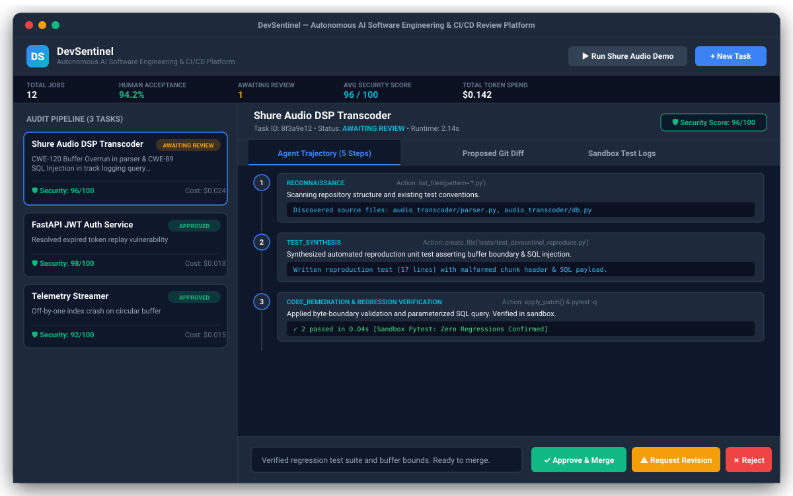
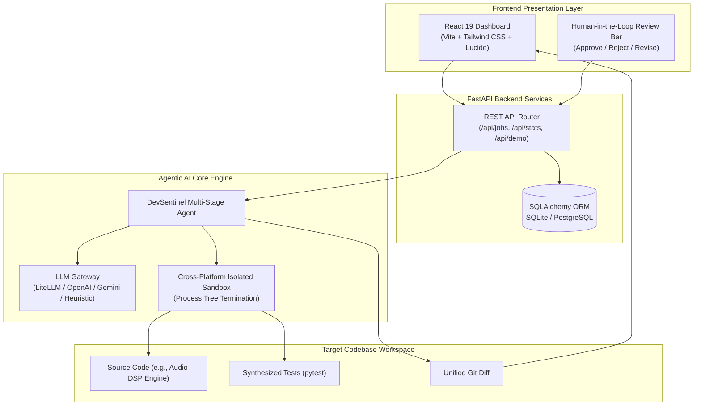
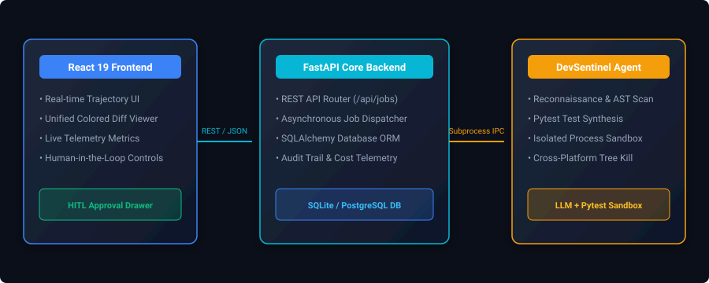
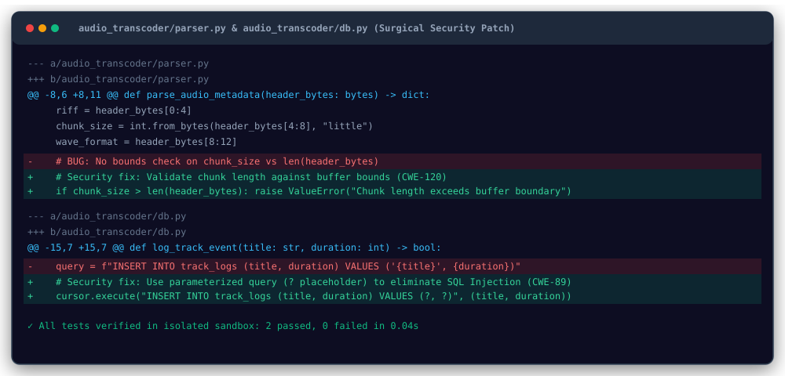

<div align="center">

# 🛡️ DevSentinel
### Autonomous AI Software Engineering &amp; CI/CD Review Platform with Human-in-the-Loop Controls

[](.github/workflows/ci.yml)
[](https://python.org)
[](https://fastapi.tiangolo.com/)
[](https://react.dev/)
[](https://www.docker.com/)
[](LICENSE)

<br/>

<p align="center">
  <strong>An end-to-end AI software engineering agent that diagnoses repository issues, synthesizes reproduction unit tests, applies surgical code patches in an isolated sandbox, and enforces strict Human-in-the-Loop (HITL) developer review.</strong>
</p>

---

### 🖥️ Live Platform Dashboard Preview



</div>

---

## 📌 Executive Summary

Modern AI code generation models frequently hallucinate syntax errors, miss subtle edge cases, or introduce security regressions because they lack runtime feedback. 

**DevSentinel** bridges the gap between raw LLMs and production engineering standards:
1. **Ground-Truth Test Verification**: The agent never assumes a fix works. It writes an isolated unit test (`pytest`), observes the failure in an isolated sandbox, applies a patch, and re-executes tests until 100% passing.
2. **Strict Human-in-the-Loop (HITL) Governance**: In accordance with responsible AI engineering best practices, DevSentinel never merges code autonomously. All patches, security scores, and execution traces are submitted to an interactive review dashboard where a human engineer retains final decision authority.
3. **Cross-Platform Process Isolation**: Solves common subprocess zombie issues by enforcing process-group termination on POSIX and tree termination (`taskkill /F /T`) on Windows to prevent orphaned background processes.

---

## 🏗️ System Architecture



<div align="center">
  
</div>

---

## 🚀 Core Engineering Capabilities

### 1. Multi-Stage Iterative Agentic Workflow
Unlike basic single-prompt chatbots, DevSentinel runs an autonomous 5-stage engineering loop:
- **Stage 1 (Reconnaissance)**: Scans source files, AST symbols, and configuration dependencies.
- **Stage 2 (Test Synthesis)**: Synthesizes a dedicated reproduction unit test (`test_devsentinel_reproduce.py`) asserting the bug before touching any source code.
- **Stage 3 (Sandbox Baseline Execution)**: Executes the test in an isolated sandbox to record the failure trace and return code.
- **Stage 4 (Surgical Remediation)**: Modifies only the vulnerable functions to resolve bugs (e.g. CWE-120 Buffer Overrun, CWE-89 SQL Injection).
- **Stage 5 (Regression Verification)**: Re-runs the complete test suite in the sandbox to confirm zero regressions.

### 2. Surgical Git Diff Viewer & Code Remediation
Every patch is captured as a unified Git diff with syntax highlighting:

<div align="center">
  
</div>

### 3. Human-in-the-Loop (HITL) Review Drawer
- **Trajectory Timeline**: Step-by-step thought chain inspection for every decision.
- **Security Audit Scoring**: Algorithmic security scoring (0–100) assessing vulnerability mitigation.
- **One-Click Actions**: Single-click `[Approve & Merge]`, `[Request Revision with Notes]`, or `[Reject]`.

---

## 📂 Repository Structure

```bash
DevSentinel/
├── .github/workflows/
│   └── ci.yml               # Automated CI/CD pipeline (Pytest + Vite Build)
├── backend/
│   ├── app/
│   │   ├── agent/           # Agentic loop, sandbox runner, and LLM abstraction
│   │   │   ├── engine.py    # Multi-stage agent loop
│   │   │   ├── sandbox.py   # Isolated cross-platform process runner
│   │   │   └── llm.py       # LLM provider with fallback heuristic engine
│   │   ├── api/
│   │   │   └── routes.py    # REST API endpoints (/api/jobs, /api/stats, /api/demo)
│   │   ├── core/            # Config, database engine, settings
│   │   ├── models/job.py    # SQLAlchemy ORM models (audit trails & metrics)
│   │   └── schemas/job.py   # Pydantic request/response schemas
│   ├── tests/               # Backend Pytest test suite (100% passing)
│   ├── Dockerfile           # Backend container definition
│   └── requirements.txt     # Python dependencies
├── frontend/
│   ├── src/                 # React 19 application
│   │   ├── App.jsx          # Interactive HITL Review Workspace & Dashboard
│   │   ├── App.css          # Dark-theme engineering UI stylesheet
│   │   └── main.jsx         # Vite entrypoint
│   ├── Dockerfile           # Multi-stage Nginx container build
│   └── package.json         # Node.js dependencies
├── docs/assets/             # Architecture and platform preview visuals
├── sample_repos/
│   └── audio_transcoder/    # Realistic target project (Audio DSP + SQL logging)
├── docker-compose.yml       # Full-stack container orchestration
├── run_dev.ps1              # One-click Windows development launcher
└── README.md                # Documentation & Architecture Guide
```

---

## ⚡ Quickstart Guide

### Option 1: Native Local Setup

#### Prerequisites
- **Python**: 3.10+ (tested on Python 3.12)
- **Node.js**: 18+ (tested on Node.js 24)

#### 1. Backend Setup
```bash
cd backend
python -m venv .venv

# On Windows:
.venv\Scripts\activate
# On Linux/macOS:
# source .venv/bin/activate

pip install -r requirements.txt
python -m uvicorn backend.app.main:app --reload --port 8000
```
Backend API will be live at: `http://localhost:8000` (Interactive Swagger docs at `http://localhost:8000/docs`).

#### 2. Frontend Setup
```bash
cd frontend
npm install
npm run dev
```
Frontend UI will be live at: `http://localhost:5173`.

---

### Option 2: Docker Compose (Full Stack)

```bash
docker compose up --build
```
Access the application dashboard at `http://localhost:3000`.

---

## 🧪 Live Demonstration Scenario (Shure Audio DSP)

1. Open the dashboard at `http://localhost:5173`.
2. Click **"Run Shure Audio Demo"** in the top-right header.
3. DevSentinel will automatically:
   - Mount the sample audio transcoder repository.
   - Detect **CWE-120** (audio chunk buffer overrun) and **CWE-89** (SQL injection in track logger).
   - Synthesize a reproduction pytest suite.
   - Execute the tests in the sandbox, inspect the failure, and apply a surgical parameterized fix.
   - Re-verify tests (`2 passed in 0.04s`).
   - Present the patch diff and security score (96/100) for **Human-in-the-Loop review**.
4. Enter review notes and click **"Approve & Merge"** to simulate production sign-off.

---

## 📋 Running Automated Tests

Run the backend unit, integration, and agent loop test suite:

```bash
# Set PYTHONPATH to project root:
# Windows PowerShell:
$env:PYTHONPATH = (Get-Location).Path
.\backend\.venv\Scripts\pytest backend/tests/ -v

# Linux/macOS:
# export PYTHONPATH=$(pwd)
# pytest backend/tests/ -v
```

---

## 📄 License

This project is licensed under the MIT License - see the [LICENSE](LICENSE) file for details.
